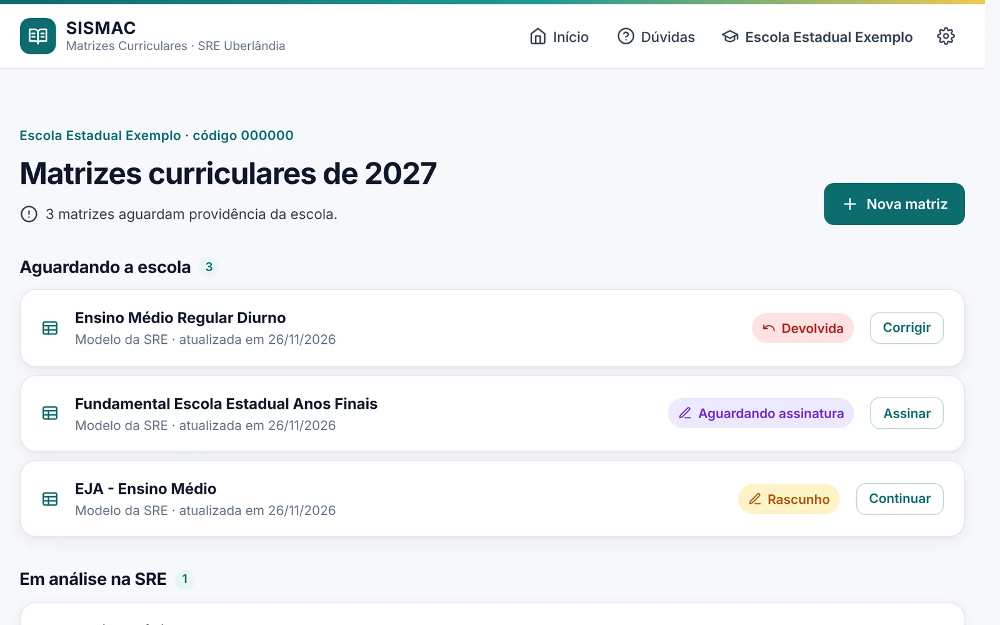

# Lucas Rocha Rodrigues · Portfólio

**Desenvolvedor de Software · Web e Back-end**
Estagiário de TI na Superintendência Regional de Ensino de Uberlândia, onde crio e mantenho sistemas web em produção usados por mais de 400 escolas. Estudante de Sistemas de Informação na UNIUBE.

**[Acessar o portfólio](https://rochlitt.github.io)** · [Baixar o currículo](https://rochlitt.github.io/curriculo.pdf) · [LinkedIn](https://www.linkedin.com/in/rochlucas)

## Em números

| 441 | 101 | 90+ | 1.000+ |
|:---:|:---:|:---:|:---:|
| escolas atendidas pelo SISCAL | escolas estaduais no SISMAC | versões publicadas em produção | verificações em testes automatizados |

## Projetos

### SISMAC · Sistema de Matrizes Curriculares
*Em produção · criado do zero · 2026*

As 101 escolas estaduais da regional montam, enviam e assinam a matriz curricular direto no sistema, sempre igual ao modelo oficial.

- Portal das escolas e painel da equipe, com 3 perfis de acesso e permissões conferidas no servidor.
- Fluxo de envio, análise pelo inspetor do setor, devolução e assinatura eletrônica.
- Importador em Node.js que converteu 236 modelos oficiais de Word e Excel em dados.
- Validação pública dos documentos por código e QR Code gerado no próprio sistema.
- Autenticação com hash e sal, limite de tentativas e login por código no e-mail.

`JavaScript` `Google Apps Script` `Node.js` `HTML/CSS` `Git`

### SISCAL · Sistema de Calendários Escolares
*Em produção · versão 2.0 · 2026*

Uma análise de calendário podia levar dias ou semanas. Hoje cada etapa é acompanhada no painel, com lembretes às 441 escolas municipais e particulares atendidas.

- Evolução da versão 1.0 para a 2.0, com o servidor reorganizado em módulos.
- Preenchimento digital com conferência automática de dias letivos e datas.
- Assinatura eletrônica e PDF com QR Code de validação.
- Mais de 90 versões publicadas, com um script que roda os testes antes de cada publicação.

`JavaScript` `Google Apps Script` `Google Drive` `Node.js` `Git`

### Meu Plano UFU
*Projeto pessoal · em desenvolvimento*

Painel de estudos para o vestibular e a transferência da UFU: um cronograma que se refaz todo dia a partir do desempenho, dos pesos do curso e dos prazos da faculdade.

- 684 conteúdos do edital e os 46 cursos do Quadro de Pesos 2027-2.
- Funciona sem internet e sem instalação.
- Testes do motor em Node.js e de todas as telas com Playwright.

`JavaScript` `HTML/CSS` `Canvas` `Node.js` `Playwright`

### SEAR · Sistema Eletrônico de Atendimento Remoto
*Participação pontual*

Melhorias no código e na interface do sistema de atendimento da SRE e primeiras experiências com a máquina virtual no Microsoft Azure (IP, portas, regras de rede e DNS).

`React` `Microsoft Azure` `Redes e DNS`

> SISMAC, SISCAL e SEAR são sistemas de um órgão público: o código não é aberto, e as telas do portfólio usam escolas e pessoas fictícias.

## Sobre este site

Página única feita com HTML, CSS e JavaScript, sem framework, publicada pelo GitHub Pages. Tem tema claro e escuro, funciona no celular e respeita a preferência de menos animação do sistema.

## Contato

lucasrocharxd@gmail.com · [LinkedIn](https://www.linkedin.com/in/rochlucas) · Uberlândia, MG

<!--
Notas de manutenção (não aparecem na página do GitHub):
- Arquivos: index.html (a página), img/ (telas com dados fictícios) e curriculo.pdf (sem o telefone). O .nojekyll faz o GitHub Pages publicar os arquivos como estão.
- Telas novas só com dados fictícios. Imagem trocada ganha nome novo (por exemplo -v3), para o navegador não mostrar a antiga guardada.
- Trocar curriculo.pdf sempre que o currículo mudar (idade: atualizar todo 26/12).
- Quando o repositório do Meu Plano UFU ficar público: botão "Ver código" no cartão dele, link aqui e no currículo.
- Commits só no nome de Lucas Rocha Rodrigues, sem coautor.
-->
